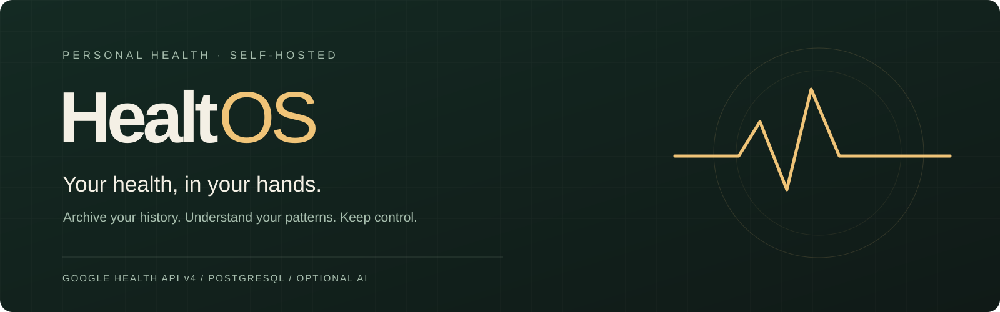
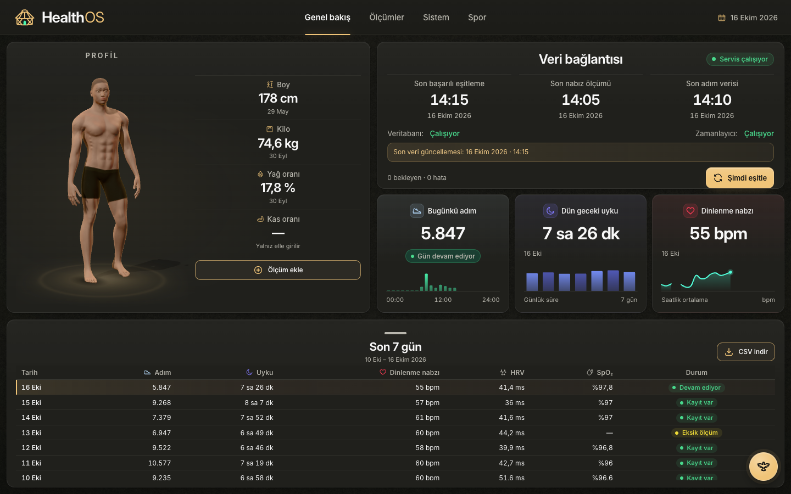
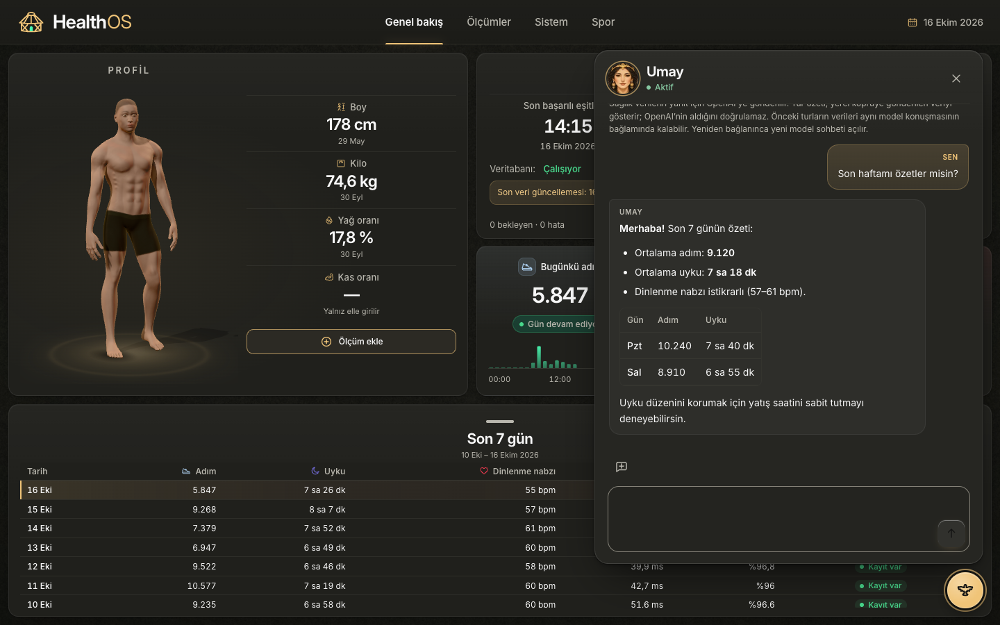
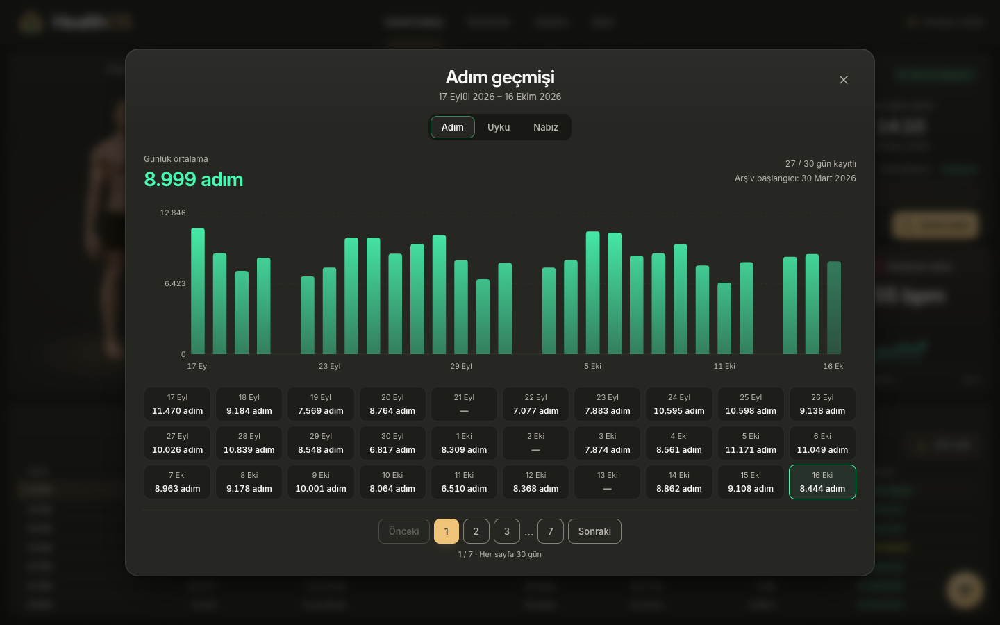
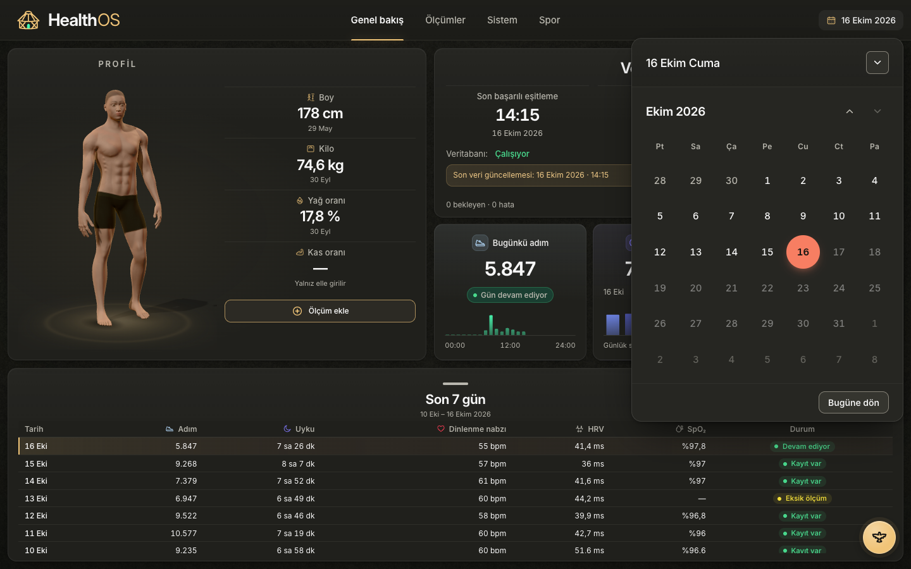
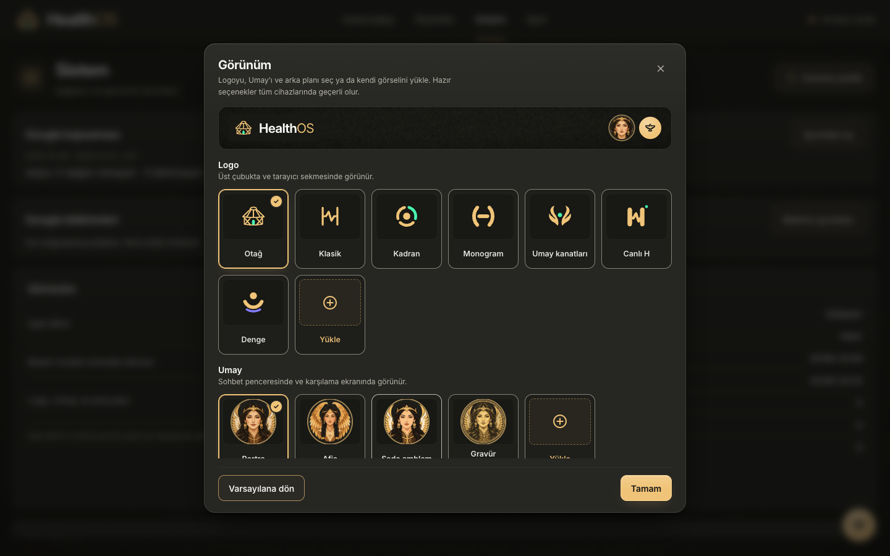
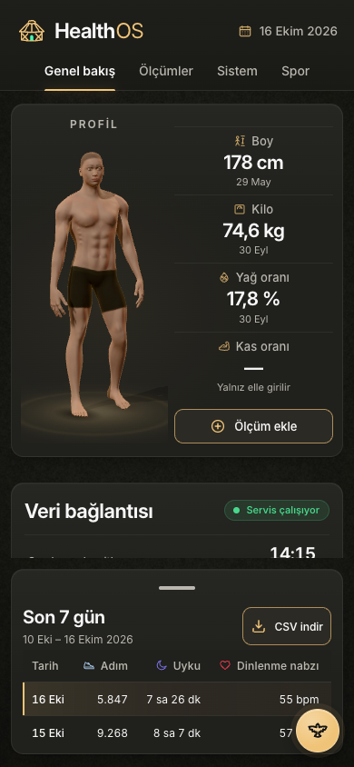
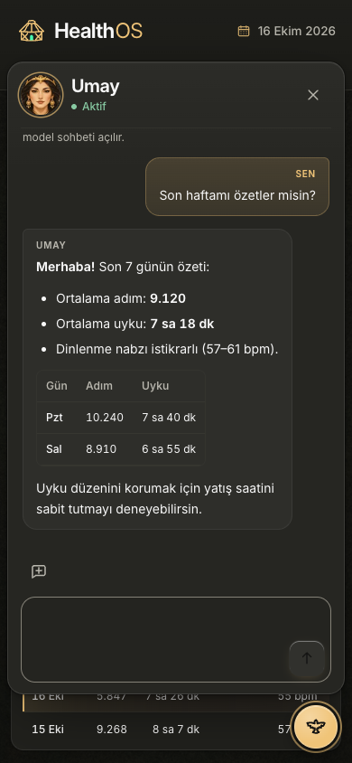
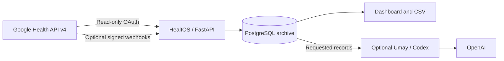

<div align="center">



<p><strong>A self-hosted, read-only archive for your Google Health data, with a calm dashboard on top.</strong></p>

[](https://github.com/M3rgen/HealtOS/actions/workflows/ci.yml)
[](https://github.com/M3rgen/HealtOS/releases/tag/v0.2.1)
[](LICENSE)


[What it does](#what-it-does) · [Preview](#a-closer-look) · [Get started](#get-started) · [Privacy](#privacy-and-scope) · [Documentation](#documentation) · [Changelog](CHANGELOG.md)

</div>

---

HealtOS copies the health and fitness records you can read through **Google Health API v4** into a PostgreSQL database you operate. It keeps the original payloads before anything is normalized, shows daily movement, sleep, heart rate, HRV and oxygen saturation in a single-screen dashboard, and lets you export your history whenever you want. An optional companion, **Umay**, can help you read the archive through a separate Codex conversation.

The archive and dashboard need no AI subscription. HealtOS is a personal, single-user application, not a hosted or multi-user service.

> [!NOTE]
> **Language.** Most documentation is in English; the dashboard, Umay's voice and a few newer operational notes are in Turkish.
>
> **Fitbit Web API shutdown.** Support for the legacy Fitbit Web API ended on September 30, 2026, and the API shut down completely on October 30, 2026. HealtOS uses only Google Health API v4 (`health.googleapis.com/v4`), Google OAuth and `googlehealth.*` scopes, so it is not affected.
>
> *Eski Fitbit Web API'nin desteği 30 Eylül 2026'da sona erdi ve API 30 Ekim 2026'da tamamen kapandı. HealtOS yalnızca Google Health API v4'ü (`health.googleapis.com/v4`), Google OAuth'u ve `googlehealth.*` scope'larını kullandığı için bu kapanıştan etkilenmez.*

> [!IMPORTANT]
> **API availability.** As of October 3, 2026, Google says new Google Health API projects are not being onboarded. Real synchronization requires an eligible Google Cloud project and a linked Google Health account. Without credentials you can still run the empty dashboard, manual entries and the automated tests. Check the [official setup guide](https://developers.google.com/health/setup) before planning an integration.

## What it does

| Capability | What it gives you |
| --- | --- |
| **Daily overview** | Steps, sleep, resting heart rate, HRV and SpO₂, with hourly charts where records exist. |
| **History and export** | Weekly and monthly views, a draggable history panel and CSV downloads. |
| **Body and workouts** | Manual body measurements and workouts next to archived source records, on one workout timeline. Manual entries can be flagged as test entries without being deleted. |
| **Raw-first storage** | Original payloads and verbatim Google responses are kept before normalization; unknown fields stay available, and record versions are preserved rather than overwritten. |
| **Reliable archiving** | Resumable backfills, overlapping incremental sync, signed webhooks, daily reconciliation and persisted checkpoints. |
| **Evidence you can check** | A coverage report per data type and day with retrieval receipts, a reconciliation history of new, changed and source-deleted records, and webhook diagnostics with separate failure counters. |
| **Local operations** | Encrypted PostgreSQL backups with a status endpoint, integrity checks, sync status and bounded automatic recovery. |
| **Optional Umay chat** | Read-only archive tools for summaries, personal baselines, sleep, intraday and session structure, and a per-turn receipt of what was sent to the model. |

Missing measurements stay missing; they never become zero. Google health-data endpoints are read-only in this application, and manual entries live separately in your local database.

## A closer look



<table>
<tr>
<td width="50%" valign="top"><br /><sub><b>Umay.</b> The optional chat bubble answers from your archive and shows a per-turn receipt of what was sent.</sub></td>
<td width="50%" valign="top"><br /><sub><b>Metric history.</b> Steps, sleep and resting heart rate in 30-day pages; missing days stay empty.</sub></td>
</tr>
<tr>
<td width="50%" valign="top"><br /><sub><b>Date picker.</b> Open any earlier day from the header; the cards and the seven-day table follow it.</sub></td>
<td width="50%" valign="top"><br /><sub><b>Appearance.</b> Logo, Umay portrait and background presets, or your own image. Presets follow you across devices; uploads stay in the browser.</sub></td>
</tr>
</table>

<sub>Actual application interface, captured with the synthetic preview harness in <code>frontend/preview</code> (desktop 1440×900, mobile 390×844). No personal health records are included. The anatomical model is a generic reference.</sub>

<details>
<summary>See the mobile layout</summary>

<p align="center">&nbsp;</p>

</details>

## How it fits together



FastAPI serves the Vite/Three.js frontend. PostgreSQL stores the archive and synchronization state. APScheduler runs reconciliation inside the app, so no separate queue is needed. Docker builds the frontend, so the host does not need Node.js for the Docker setup. The app and database containers run with a read-only root filesystem and `no-new-privileges`.

## Get started

### Requirements

| Setup | Requirements |
| --- | --- |
| **Recommended: Docker** | Git, Docker Engine or Docker Desktop, Docker Compose v2, and a modern browser with WebGL. |
| **Native development** | Python 3.12+, `uv` 0.12.1, PostgreSQL, and Node.js 24 for frontend builds. The shipped Compose stack uses PostgreSQL 17. |
| **Google synchronization** | An eligible Google Cloud project, Google Health API access, an OAuth web client, and a linked Google Health account. |
| **Server deployment** | A Linux VM (Debian is documented) with Docker Engine; see [Deployment](docs/DEPLOYMENT.md). |
| **Optional webhooks** | A public HTTPS endpoint that forwards only `/webhooks/google-health`; the documented setup uses a Cloudflare Tunnel. |
| **Optional Umay** | A compatible Codex CLI and an authenticated ChatGPT account on the Docker host; the bridge launcher supports Linux, macOS and Windows. |

Internet access is needed to build images and to synchronize with Google; Umay also needs access to OpenAI. Storage depends on how much history you archive.

### 1. Clone and configure

```sh
git clone https://github.com/M3rgen/HealtOS.git
cd HealtOS
cp .env.example .env
```

Open `.env` and set two values:

- `POSTGRES_PASSWORD`: a long random value. A hexadecimal password avoids URL-escaping issues in the Compose database URL.
- `APP_UI_TOKEN`: the access key for the dashboard and API, 32 to 512 printable characters without spaces. You type it once on the login page; scripts send it as `Authorization: Bearer <token>`.

```sh
python3 -c "import secrets; print(secrets.token_hex(32))"        # POSTGRES_PASSWORD
python3 -c "import secrets; print(secrets.token_urlsafe(32))"    # APP_UI_TOKEN
```

Store the results only in `.env`. `.env` is ignored by Git; `.env.example` contains blank secret fields.

### 2. Start HealtOS

The Compose file runs the app in production mode, which refuses to start until Google and webhook credentials are configured. For a first local look without Google, add the development override:

```sh
docker compose -f docker-compose.yml -f docker-compose.dev.yml up -d --build
docker compose ps
```

Open **[localhost:8000](http://localhost:8000)** and enter your `APP_UI_TOKEN`. The first build downloads dependencies and applies database migrations. Without Google credentials the dashboard starts with an empty archive and reports incomplete Google configuration; manual entries remain available. The development override also publishes PostgreSQL on `127.0.0.1:5432`.

After logging in, [localhost:8000/health](http://localhost:8000/health) shows pipeline status. With the development override, [localhost:8000/docs](http://localhost:8000/docs) serves the interactive API documentation; production mode serves no `/docs`, `/redoc` or `/openapi.json`.

### 3. Connect Google Health

Once your project has API access:

1. Follow Google's [Cloud and OAuth setup guide](https://developers.google.com/health/setup). Link your account in the Google Health mobile app first.
2. Create a **Web application** OAuth client and allow this redirect URI: `http://localhost:8000/auth/google/callback`.
3. Configure the required **read-only** scopes. Optionally narrow the mirrored types with `ENABLED_DATA_TYPES`; see the [configuration reference](docs/REFERENCE.md#configuration).
4. Put `GOOGLE_CLIENT_ID` and `GOOGLE_CLIENT_SECRET` in `.env`. Generate a Fernet key with the built image and save it as `GOOGLE_TOKEN_ENCRYPTION_KEY`:

   ```sh
   docker compose run --rm --no-deps app python -c "from cryptography.fernet import Fernet; print(Fernet.generate_key().decode())"
   ```

5. Apply the updated environment (keep the development override until the webhook values below are set), then visit **[Connect Google](http://localhost:8000/auth/google/start)** and complete consent:

   ```sh
   docker compose -f docker-compose.yml -f docker-compose.dev.yml up -d --force-recreate app
   ```

6. Check access, then synchronize a small dataset:

   ```sh
   docker compose exec app health-mirror probe --days 30
   docker compose exec app health-mirror sync steps
   docker compose exec app health-mirror status
   ```

For unattended operation, run the plain `docker compose up -d` (production mode). It also requires an HTTPS `GOOGLE_HEALTH_WEBHOOK_ENDPOINT_URI` and a `GOOGLE_HEALTH_WEBHOOK_AUTHORIZATION` value; the [deployment guide](docs/DEPLOYMENT.md) walks through a server setup with the dashboard behind an SSH tunnel and a webhook-only Cloudflare Tunnel.

Google's Testing-mode refresh tokens expire after seven days. Follow the applicable Google publication and verification requirements before relying on unattended synchronization; details are in the [technical reference](docs/REFERENCE.md#oauth-and-google-health-setup).

### 4. Bring in your history

Set `BACKFILL_START_DATE` in `.env` to the earliest date you want to attempt, recreate the app to apply it, then run:

```sh
docker compose exec app health-mirror backfill --data-type steps
# All configured data types; this can take time:
docker compose exec app health-mirror backfill
```

Backfills save progress by type and time window; rerun an interrupted backfill to resume it. Reconciliation and incremental synchronization pick up late-arriving records.

## Optional: Umay

Umay is a calm, mythology-inspired companion for exploring your health history. It first discovers what your archive contains, then requests the summaries or original records it needs to answer. Its tools cannot modify the archive, and it does not diagnose or suggest medication or doses. Responses are informational.

The supplied launcher, `scripts/start_codex_bridge.py`, starts an isolated, authenticated Codex bridge on the Docker host; on Linux it can also run as the `healthos-bridge` systemd service in [`deploy/systemd/`](deploy/systemd/). Follow the [bridge setup](docs/REFERENCE.md#local-codex-chat-umay-bridge) or step 9 of the [deployment guide](docs/DEPLOYMENT.md#9-optional-the-umay-bridge). The persona lives in [`app/personas/umay/soul.md`](app/personas/umay/soul.md); the interpretation tools are described in [UMAY_INTERPRETATION](docs/UMAY_INTERPRETATION.md).

**What leaves your machine:** when you use Umay, your questions (with your time zone) and the results of the `health_archive` tool are sent to OpenAI. Each tool call returns a bounded slice, for example daily summaries for up to 366 days, or original Google records for at most 31 days and 200 records per page; Umay may make several calls per question. Every turn shows a transfer receipt with the record counts, date range and field list that were handed to the bridge ([UMAY_TRANSFER](docs/UMAY_TRANSFER.md)). The database itself, whole tables, OAuth tokens, secrets and backups are never sent. The core archive works without this feature.

**Gizlilik:** Umay'a sorduğunuz sorular ve `health_archive` aracının sonuçları OpenAI'ye gider; ham tablolar olduğu gibi gitmez. Araç her çağrıda sınırlı bir parça döndürür: örneğin en fazla 366 günün gün gün özeti ya da en fazla 31 günlük bir aralıktan sayfa başına 200 özgün kayıt. Umay tek bir soru için birkaç sorgu yapabilir. Veritabanının kendisi, OAuth anahtarları ve yedekler hiçbir zaman gönderilmez.

The bridge listens only on loopback or the Docker bridge address, never on all interfaces (`CODEX_BRIDGE_BIND_HOST`). On a Linux host, also restrict port 8766 to Docker bridges with [`deploy/firewall/codex-bridge.nft`](deploy/firewall/codex-bridge.nft) (or the ufw variant next to it).

## Privacy and scope

HealtOS is built for one person keeping their own records on their own hardware.

- **Personal and single-user.** There is one access token, no accounts and no hosted database. There is no application telemetry.
- **Read-only towards Google.** Only read scopes are requested; nothing is written back to Google Health.
- **Raw data is preserved.** Source payloads, verbatim responses and record versions are kept; corrections, test-entry flags and identity decisions are recorded alongside the data instead of overwriting it.
- **Nothing listens publicly.** The application port binds to `127.0.0.1` and PostgreSQL has no published port. The dashboard and administrative API stay private behind `APP_UI_TOKEN` and an SSH tunnel; a public deployment exposes only the webhook route, with request-size and rate limits.
- **Secrets stay local.** OAuth refresh tokens are encrypted in PostgreSQL; keep the encryption key separately. Real health records, secrets, logs, backups and local verification outputs are excluded from this repository.

### Backups

Backups are encrypted and automated: a systemd timer ([`deploy/systemd/`](deploy/systemd/healthos-backup.timer)) runs [`scripts/backup.sh`](scripts/backup.sh) daily at 03:30. It streams `pg_dump` from the Compose `backup` profile through `age` (preferred) or `gpg --symmetric`, writes `BACKUP_HOST_DIR/health-<stamp>.dump.age`, and **keeps every backup forever**: nothing is deleted unless you opt in with `BACKUP_RETENTION_DAYS`. A run refuses to start when the disk is short of space (it never deletes old backups to make room) and records its result in `BACKUP_HOST_DIR/last-backup-status.json`; a separate, read-only status directory lets the app report the last attempt and last success at `GET /health/backup`. The key lives outside `.env` (`BACKUP_AGE_RECIPIENT` or a mode-600 `/etc/healthos/backup.key`). **Keep a copy of the backup key (or age identity) off the host, for example in a password manager: if it is lost, every backup is unreadable.**

```sh
make backup                                         # one encrypted backup now
make restore FILE=backups/health-<stamp>.dump.age   # restore drill into a scratch database
docker compose exec app health-mirror verify
```

`scripts/restore.sh` never touches the live database: it restores into `health_restore` and compares row counts. Keep `GOOGLE_TOKEN_ENCRYPTION_KEY` with the backup key, away from the backups; a restored archive needs it to decrypt the stored Google tokens. See the [backup and restore reference](docs/REFERENCE.md#database-backup-and-restore) and the [restore drill](docs/RUNBOOK.md#backup-verify-and-restore-drill).

## Documentation

| Guide | Use it for |
| --- | --- |
| [Technical reference](docs/REFERENCE.md) | Data types, scopes, configuration, APIs, record identity, archiving, backups and troubleshooting. |
| [Deployment](docs/DEPLOYMENT.md) | Installing on a Debian VM: Compose, SSH-tunnel access, webhook tunnel, backups, Umay bridge. |
| [Runbook](docs/RUNBOOK.md) | Updates, migrations, key rotation, restore drills and diagnosing a quiet webhook. |
| [Development](docs/DEVELOPMENT.md) | Native setup, validation commands and repository map. |
| [Branches](docs/BRANCHES.md) | `dev`, `main`, extension branches and `live`: what is published and what is installed. |
| [Umay interpretation](docs/UMAY_INTERPRETATION.md) | Baselines, analysis, sleep, intraday, session and relationship tools, and their budgets (Turkish). |
| [Umay transfer receipts](docs/UMAY_TRANSFER.md) | What each chat turn sends to the model and how it is counted. |
| [Performance budget](docs/PERFORMANCE_BUDGET.md) | Initial JS/CSS size ceilings enforced after `vite build` (Turkish). |
| [Cloudflare Tunnel](docs/CLOUDFLARE_TUNNEL.md) | A webhook-only public endpoint. |
| [Image updates](docs/IMAGE_UPDATES.md) | Updating pinned container images. |
| [Legacy notes](docs/legacy/WINDOWS.md) | Running on Windows and the earlier Windows → Linux migration plan. |
| [Changelog](CHANGELOG.md) | What changed in each release. |

## Contributing

Contributions are welcome. Keep changes focused, use synthetic examples only and run the validation described in [CONTRIBUTING.md](CONTRIBUTING.md) and [Development](docs/DEVELOPMENT.md#validation). Never include real health records, tokens or `.env` contents in issues, pull requests or fixtures.

## Project status and license

**Current release: [v0.2.1](https://github.com/M3rgen/HealtOS/releases/tag/v0.2.1).** HealtOS is an evolving personal self-hosted project. The public snapshot includes the application, migrations, deterministic dependency locks, automated tests and CI. Google access and available records vary by project and account. The interface is Turkish, defaults to UTC, and has English documentation.

Project code is available under the [MIT License](LICENSE). The generic anatomical model retains its [MakeHuman provenance and CC0 license](frontend/public/models/PROVENANCE.md).

HealtOS is an independent project and is not affiliated with Google, Fitbit or OpenAI.
