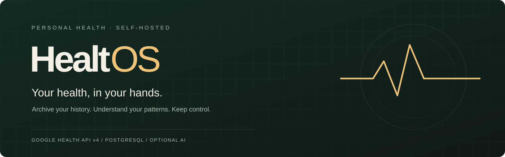
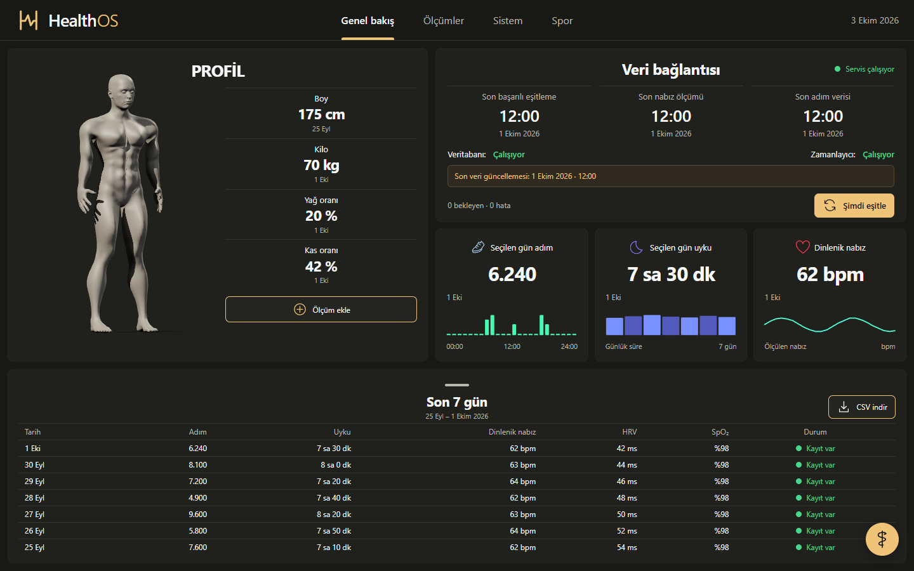
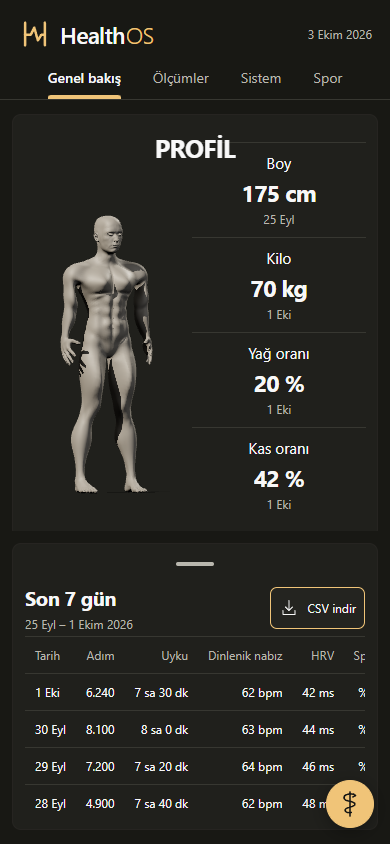
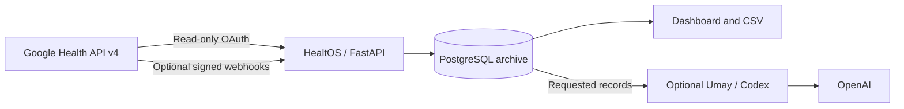

<div align="center">



<p>A personal health archive. A calm dashboard. A home for your data.</p>

[](https://github.com/M3rgen/HealtOS/actions/workflows/ci.yml)
[](https://github.com/M3rgen/HealtOS/tree/v0.5.0)
[](LICENSE)


[Get started](#get-started) · [Preview](#a-closer-look) · [Documentation](#documentation) · [Contribute](CONTRIBUTING.md)

</div>

## Your history deserves a home

HealtOS brings health and fitness records from **Google Health API v4** into a database you operate. Explore daily movement, sleep, resting heart rate, HRV, and oxygen saturation in a focused dashboard. Keep the original records for future analysis, and export your history when you need it.

The interface pairs a warm dark palette with a 3D anatomical reference and a compact, single-screen layout. An optional companion, **Umay**, helps you explore the archive through a separate Codex conversation.

The archive and dashboard run without an AI subscription. Umay is optional and requires compatible Codex access. **Documentation is in English; the current dashboard and Umay voice are in Turkish.** HealtOS is a personal self-hosted application, not a public multi-user service.

> **Fitbit Web API shutdown:** support for the legacy Fitbit Web API ended on September 30, 2026, and the API shuts down completely on October 30, 2026. HealtOS uses only Google Health API v4 (`health.googleapis.com/v4`), Google OAuth, and `googlehealth.*` scopes, so it is not affected by that shutdown.
>
> *Eski Fitbit Web API'nin desteği 30 Eylül 2026'da sona erdi ve API 30 Ekim 2026'da tamamen kapanıyor. HealthOS yalnızca Google Health API v4'ü (`health.googleapis.com/v4`), Google OAuth'u ve `googlehealth.*` scope'larını kullandığı için bu kapanıştan etkilenmez.*

> **API availability:** As of October 3, 2026, Google says new Google Health API projects are not being onboarded. Real synchronization requires an eligible Google Cloud project and a linked Google Health account. You can still run the empty dashboard, manual entries, and automated tests without Google credentials. Check the [official setup guide](https://developers.google.com/health/setup) before planning an integration.

## A closer look



<sub>Actual application interface, captured with synthetic demonstration records. No personal health records are included. The anatomical model is a generic reference.</sub>

<details>
<summary>See the mobile layout</summary>

<p align="center"></p>

</details>

## What you can do

| Capability | What it gives you |
| --- | --- |
| **Daily overview** | Steps, sleep, resting heart rate, HRV, and SpO₂, with hourly charts where records exist. |
| **History and export** | Weekly and monthly views, a draggable history panel, and CSV downloads. |
| **Body and workouts** | Manual body measurements and workouts alongside archived source records. |
| **Reliable archiving** | Resumable backfills, overlapping incremental sync, reconciliation, and persisted checkpoints. |
| **Raw-first storage** | Original payloads retained before normalization; unknown fields remain available. |
| **Local operations** | PostgreSQL backups, integrity checks, sync status, and recovery monitoring. |
| **Optional Umay chat** | Read tools for summaries and archived records, streamed responses, and a configurable persona. |

Missing measurements remain missing, rather than becoming zero. Google health-data endpoints are read-only in this application; manual entries live separately in your local database.

## How it fits together



FastAPI serves the Vite/Three.js frontend. PostgreSQL stores the archive and synchronization state. APScheduler handles reconciliation inside the app; no separate queue is required. Docker builds the frontend, so Node.js is not required on the host for the Docker setup.

## Requirements

| Setup | Requirements |
| --- | --- |
| **Recommended: Docker** | Git, Docker Engine or Docker Desktop, Docker Compose v2, and a modern browser with WebGL. |
| **Native development** | Python 3.12+, `uv` 0.12.1, PostgreSQL, and Node.js 24 for frontend builds. The shipped Compose stack uses PostgreSQL 17. |
| **Google synchronization** | An eligible Google Cloud project, Google Health API access, an OAuth web client, and a linked Google Health account. |
| **Server deployment** | A Linux VM (Debian is documented) with Docker Engine; see [Deployment](docs/DEPLOYMENT.md). |
| **Optional webhooks** | A public HTTPS endpoint that forwards only `/webhooks/google-health`; the documented setup uses a Cloudflare Tunnel. |
| **Optional Umay** | A compatible Codex CLI and authenticated ChatGPT account on the Docker host; the bridge launcher supports Linux, macOS, and Windows. |

Internet access is needed to build images and synchronize with Google. AI analysis also needs access to OpenAI. Storage requirements depend on the amount of history you archive.

## Get started

### 1. Clone the repository

```sh
git clone https://github.com/M3rgen/HealtOS.git
cd HealtOS
```

### 2. Create your private configuration

```sh
cp .env.example .env
```

Open `.env` in your editor and set two values:

- `POSTGRES_PASSWORD`: a long random value. A hexadecimal password avoids URL-escaping issues in the
  Compose database URL.
- `APP_UI_TOKEN`: the access key for the dashboard and API, 32 to 512 printable characters without
  spaces. You type it once on the login page; scripts send it as `Authorization: Bearer <token>`.

If Python is installed, generate them locally with:

```sh
python3 -c "import secrets; print(secrets.token_hex(32))"        # POSTGRES_PASSWORD
python3 -c "import secrets; print(secrets.token_urlsafe(32))"    # APP_UI_TOKEN
```

Store the results only in `.env`. `.env` is ignored by Git; `.env.example` contains blank secret fields.

### 3. Start HealtOS

The Compose file runs the app in production mode, which refuses to start until Google and webhook
credentials are configured. For a first local look without Google, add the development override:

```sh
docker compose -f docker-compose.yml -f docker-compose.dev.yml up -d --build
docker compose ps
```

Open **[localhost:8000](http://localhost:8000)** and enter your `APP_UI_TOKEN` on the login page. The
first build downloads dependencies and applies database migrations. Without Google credentials, the
dashboard starts with an empty archive and reports incomplete Google configuration; manual entries
remain available. The development override also publishes PostgreSQL on `127.0.0.1:5432`.

After logging in, [localhost:8000/health](http://localhost:8000/health) shows pipeline status. With
the development override, [localhost:8000/docs](http://localhost:8000/docs) serves the interactive
API documentation; production mode serves no `/docs`, `/redoc` or `/openapi.json`.

### 4. Connect Google Health

Once your project has API access:

1. Follow Google's [Cloud and OAuth setup guide](https://developers.google.com/health/setup). Link your account in the Google Health mobile app first.
2. Create a **Web application** OAuth client and allow this redirect URI: `http://localhost:8000/auth/google/callback`.
3. Configure the required **read-only** scopes. Optionally narrow the mirrored types with `ENABLED_DATA_TYPES`; see the [configuration reference](docs/REFERENCE.md#configuration).
4. Put `GOOGLE_CLIENT_ID` and `GOOGLE_CLIENT_SECRET` in `.env`. Generate a Fernet key with the built image and save it as `GOOGLE_TOKEN_ENCRYPTION_KEY`:

   ```sh
   docker compose run --rm --no-deps app python -c "from cryptography.fernet import Fernet; print(Fernet.generate_key().decode())"
   ```

5. Apply the updated environment (keep the development override until the webhook values below are set):

   ```sh
   docker compose -f docker-compose.yml -f docker-compose.dev.yml up -d --force-recreate app
   ```

   Visit **[Connect Google](http://localhost:8000/auth/google/start)** and complete consent.

6. Check accessibility, then synchronize a small dataset:

   ```sh
   docker compose exec app health-mirror probe --days 30
   docker compose exec app health-mirror sync steps
   docker compose exec app health-mirror status
   ```

For unattended operation, run the plain `docker compose up -d` (production mode). It additionally requires an HTTPS `GOOGLE_HEALTH_WEBHOOK_ENDPOINT_URI` and a `GOOGLE_HEALTH_WEBHOOK_AUTHORIZATION` value; the [deployment guide](docs/DEPLOYMENT.md) walks through a server setup with the dashboard behind an SSH tunnel and a webhook-only Cloudflare Tunnel.

Google's Testing-mode refresh tokens expire after seven days. Follow the applicable Google publication and verification requirements before relying on unattended synchronization. Detailed guidance is in the [technical reference](docs/REFERENCE.md#oauth-and-google-health-setup).

### 5. Bring in your history

Set `BACKFILL_START_DATE` in `.env` to the earliest date you want to attempt, and recreate the app to apply it. Then run:

```sh
docker compose exec app health-mirror backfill --data-type steps
# All configured data types; this can take time:
docker compose exec app health-mirror backfill
```

Backfills save progress by type and time window. Rerun an interrupted backfill to resume it. Reconciliation and incremental synchronization help pick up late-arriving records.

## Optional: meet Umay

Umay is a warm, mythology-inspired companion for exploring your health history. It first discovers what your archive contains, then requests the summaries or original records needed to answer your question. Its health tools cannot modify the archive.

The supplied launcher, `scripts/start_codex_bridge.py`, creates an isolated, authenticated Codex bridge on the Docker host. Follow the [bridge setup](docs/REFERENCE.md#local-codex-chat-umay-bridge) (or step 9 of the [deployment guide](docs/DEPLOYMENT.md#9-optional-the-umay-bridge)) to enable it. The persona lives in [`app/personas/umay/soul.md`](app/personas/umay/soul.md).

**Privacy boundary:** when you use Umay, your questions (with your time zone) and the results of the `health_archive` tool are sent to OpenAI. Each tool call returns a bounded slice: daily summaries for up to 366 days, or original Google records for at most 31 days and 200 records per page; Umay may make several calls per question. The database itself, whole tables, OAuth tokens, secrets and backups are never sent. The core archive works independently of this feature. AI responses are informational, not a diagnosis.

**Gizlilik:** Umay'a sorduğunuz sorular ve `health_archive` aracının sonuçları OpenAI'ye gider; ham tablolar olduğu gibi gitmez. Araç her çağrıda sınırlı bir parça döndürür: en fazla 366 günün gün gün özeti ya da en fazla 31 günlük bir aralıktan sayfa başına 200 özgün kayıt. Umay tek bir soru için birkaç sorgu yapabilir. Veritabanının kendisi, OAuth anahtarları ve yedekler hiçbir zaman gönderilmez.

The bridge listens only on loopback or the Docker bridge address, never on all interfaces (`CODEX_BRIDGE_BIND_HOST`). On a Linux host, also restrict port 8766 to Docker bridges with [`deploy/firewall/codex-bridge.nft`](deploy/firewall/codex-bridge.nft) (or the ufw variant next to it).

## Keep your archive yours

- The default application port binds to `127.0.0.1`; PostgreSQL has no published port.
- There is no application telemetry or hosted database requirement.
- OAuth refresh tokens obtained by the callback are encrypted in PostgreSQL; protect the encryption key separately.
- Real health records, secrets, logs, backups, and local verification outputs are excluded from this repository.
- The dashboard and API require `APP_UI_TOKEN` (login page or bearer header), on top of the loopback binding.
- A public webhook deployment should expose only the webhook route. The dashboard and administrative API should stay private; reach them through an SSH tunnel.

Backups are encrypted and automated: a systemd timer ([`deploy/systemd/`](deploy/systemd/healthos-backup.timer)) runs [`scripts/backup.sh`](scripts/backup.sh) daily at 03:30. It streams `pg_dump` from the Compose `backup` profile through `age` (preferred) or `gpg --symmetric`, writes `BACKUP_HOST_DIR/health-<stamp>.dump.age`, and **keeps every backup forever**: nothing is deleted unless you opt in with `BACKUP_RETENTION_DAYS`. A run refuses to start when the disk is short of space (it never deletes old backups to make room), and each run records its result in `BACKUP_HOST_DIR/last-backup-status.json`. The key lives outside `.env` (`BACKUP_AGE_RECIPIENT` or a mode-600 `/etc/healthos/backup.key`). **Keep a copy of the backup key (or age identity) off the host, e.g. in a password manager: if it is lost, every backup is unreadable.**

```sh
make backup                                   # one encrypted backup now
make restore FILE=backups/health-<stamp>.dump.age   # restore drill into a scratch database
docker compose exec app health-mirror verify
```

`scripts/restore.sh` never touches the live database: it restores into `health_restore` and prints row counts. Keep `GOOGLE_TOKEN_ENCRYPTION_KEY` with the backup key, away from the backups — a restored archive needs it to decrypt the stored Google tokens. See the [backup and restore reference](docs/REFERENCE.md#database-backup-and-restore) and the [restore drill](docs/RUNBOOK.md#backup-verify-and-restore-drill).

## Documentation

| Guide | Use it for |
| --- | --- |
| [Technical reference](docs/REFERENCE.md) | Data types, scopes, configuration, APIs, archiving, backups, and troubleshooting. |
| [Development](docs/DEVELOPMENT.md) | Native setup, test commands, and project layout. |
| [Deployment](docs/DEPLOYMENT.md) | Installing on a Debian VM: Compose, SSH-tunnel access, webhook tunnel, backups, Umay bridge. |
| [Runbook](docs/RUNBOOK.md) | Updates, migrations, key rotation, restore drills, and diagnosing a quiet webhook. |
| [Cloudflare Tunnel](docs/CLOUDFLARE_TUNNEL.md) | A webhook-only public endpoint. |
| [Image updates](docs/IMAGE_UPDATES.md) | Updating pinned container images. |
| [Legacy notes](docs/legacy/WINDOWS.md) | Running on Windows and the earlier Windows → Linux migration plan. |
| [Contributing](CONTRIBUTING.md) | Focused changes, privacy-safe examples, and validation. |

## Project status and license

**Current version: 0.5.0.** HealtOS is an evolving personal self-hosted project. The public snapshot includes the application, migrations, deterministic dependency locks, automated tests, and CI. Google access and available records vary by project and account. The current interface is Turkish, defaults to UTC, and has English documentation.

Project code is available under the [MIT License](LICENSE). The generic anatomical model retains its [MakeHuman provenance and CC0 license](frontend/public/models/PROVENANCE.md).

HealtOS is an independent project and is not affiliated with Google, Fitbit, or OpenAI.
