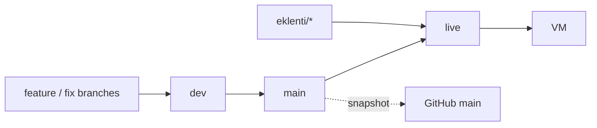

# Branches

HealtOS is developed on a private Git mirror and published on GitHub. A few features run only on
the maintainer's own server; they live on separate extension branches so that the public tree
never needs hand-pruning before a release.

## Layout

| Branch | Meaning | Published to GitHub |
| --- | --- | --- |
| `dev` | Continuous work. Feature and fix branches merge here first. Contains no extension code. | No |
| `main` | Stable. Updated from `dev` when a batch is verified. Contains no extension code; its tree is what GitHub `main` shows, less the snapshot exclusions. | Yes, as a snapshot |
| `eklenti/<name>` | One private extension, nothing else. Starts from `main` and carries only the extension's own files and lines. | **Never** |
| `live` | `main` merged with every extension branch. The commit installed on the maintainer's VM. | **Never** |



## Flow

1. Work lands on `dev` (`git merge --no-ff <branch>`), then `make verify` on `dev`.
2. A verified `dev` is merged into `main`.
3. Each extension branch takes the new `main` (see below) and is verified on its own.
4. `live` is rebuilt from `main` plus the extensions and installed on the VM:

   ```sh
   git switch live
   git merge --ff-only main            # or --no-ff when live already holds extension merges
   git merge --no-ff eklenti/<name>    # once per extension branch
   make verify
   ```

5. GitHub `main` receives the tree of `main` through the snapshot below. Nothing is pruned by
   hand; if a pruning step seems necessary, extension code has leaked into `main` and must be
   moved back to its branch first.

History is never rewritten and nothing is force-pushed. Removing a feature from `main`/`dev`
happens with an ordinary removal commit; the extension branch adds it back.

## Keeping an extension up to date

Prefer merging over rebasing, because the extension branch is already on the mirror and a rebase
would need a force push:

```sh
git switch eklenti/<name>
git merge main                      # resolve conflicts only in the extension's own lines
make verify
git diff main eklenti/<name> --stat # must list only the extension's files
```

`git rebase main` is acceptable only while the branch has never been pushed.

When `main` changes code the extension hooks into (for example the scheduler, the runtime
container or the settings class), adapt the extension in its own branch; never add hooks for an
extension to `main` or `dev`.

## Rules

- `live` and `eklenti/*` are never pushed to GitHub, not even temporarily.
- The VM is installed from `live`, not from `main` (see [DEPLOYMENT.md](DEPLOYMENT.md)).
- Extension settings stay in the VM's `.env`; `.env.example` on `main` does not list them.
- `scripts/check_no_extension.sh` checks locally that `main` and `dev` contain no trace of an
  extension branch. The words it looks for are kept out of the repository; set them once per
  clone with `git config --add healthos.extensionMarker <word>` (without one it exits 2 rather
  than report clean). Run it before every update of GitHub `main`. It is not part of CI.

## GitHub snapshot

GitHub `main` is not pushed from `main` directly. `scripts/github_snapshot.sh` builds one commit
whose tree is the tree of `main` minus a short exclusion list, on top of the local `github-main`
branch, and fast-forwards that branch; it works in a temporary index and never touches a working
tree. The exclusion list and the commit identity are local git settings, not files in the
repository (`git config --add healthos.githubExclude <path>`, `healthos.githubAuthorName`,
`healthos.githubAuthorEmail`). The list holds maintainer-only material: notes and workflow files of
the private automation, and documents or tests tied to the maintainer's own archive or devices. An
entry may be a file or a directory. The script refuses to update the branch while the new tree
still names an excluded file (by name, or as a whole word without its extension, which catches an
import of an excluded test helper) or an excluded directory, so public files must not link to or
import them; a test that imports an excluded helper is excluded with it. Contribution rules live
in `CONTRIBUTING.md`, which is published.
Run `scripts/check_no_extension.sh github-main` on the result before any push.
