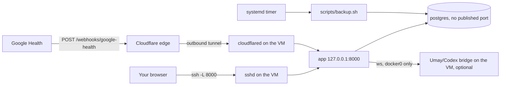

# Deployment

This is the supported way to run HealtOS for real: one Debian VM running Docker Compose, the
dashboard reachable only through an SSH tunnel, and a Cloudflare Tunnel that forwards nothing but
Google's webhook. Day-two procedures (updates, key rotation, restore drills, diagnosis) are in the
[runbook](RUNBOOK.md). For a quick local trial without Google, the [README](../README.md#get-started)
is enough.

Placeholders: `<vm-host>` is the VM's SSH address, `<user>` your SSH account, `webhook.example.com`
the public webhook hostname, `/opt/healthos` the checkout directory (the systemd backup unit assumes
that path; adjust it there if you choose another).

## What runs where



| Component | Where | Source in this repository |
| --- | --- | --- |
| `app` (FastAPI + built frontend) | Compose, published on `127.0.0.1:${APP_PORT:-8000}` only | `Dockerfile`, `docker-compose.yml` |
| `postgres` 17 | Compose, internal network, no host port, volume `postgres_data` | `docker-compose.yml` |
| `backup` | Compose profile, started on demand by the backup script | `docker-compose.yml`, `scripts/backup.sh` |
| Backup schedule | Host systemd timer, daily 03:30 | `deploy/systemd/` |
| Webhook ingress | Host `cloudflared` systemd service | `deploy/cloudflare/`, [CLOUDFLARE_TUNNEL.md](CLOUDFLARE_TUNNEL.md) |
| Umay bridge (optional) | Host process on port 8766, firewalled to Docker bridges | `scripts/start_codex_bridge.py`, `deploy/firewall/` |

Nothing listens publicly: the router needs no port forwarding, and the VM's firewall only needs to
allow SSH from your management network plus outbound HTTPS/DNS. The `caddy` service in the `webhook`
profile is an alternative that needs inbound ports 80/443; this guide does not use it.

## 1. Prepare the VM

A current Debian release with a few GB of disk beyond the archive itself is enough. Install Docker
Engine and the Compose plugin with [Docker's Debian instructions](https://docs.docker.com/engine/install/debian/),
then the tools the scripts use:

```sh
sudo apt install git age        # age encrypts backups; gpg works as a fallback
sudo systemctl enable --now docker
docker compose version
```

Docker starts at boot, and the containers come back on their own (`restart: unless-stopped`).

## 2. Get the code

```sh
sudo git clone https://github.com/M3rgen/HealtOS.git /opt/healthos
sudo chown -R "$USER" /opt/healthos
cd /opt/healthos
cp .env.example .env
chmod 600 .env
```

Your user must be able to run `docker` (member of the `docker` group, or use `sudo`).

## 3. Fill in `.env`

The Compose file always starts the app with `APP_ENV=production`. In that mode the app refuses to
start, and logs `unsafe or missing production configuration: <names>`, unless all of these are set
to real values:

| Variable | How to get it |
| --- | --- |
| `POSTGRES_PASSWORD` | `python3 -c "import secrets; print(secrets.token_hex(32))"` (hex avoids URL escaping). |
| `APP_UI_TOKEN` | `python3 -c "import secrets; print(secrets.token_urlsafe(32))"`. 32–512 printable characters, no spaces. This is the dashboard password. |
| `GOOGLE_CLIENT_ID`, `GOOGLE_CLIENT_SECRET` | Your OAuth **Web application** client ([README step 4](../README.md#4-connect-google-health)). Keep the redirect URI `http://localhost:8000/auth/google/callback`; it works through the SSH tunnel below. |
| `GOOGLE_TOKEN_ENCRYPTION_KEY` | A Fernet key; see the command below. It encrypts the stored refresh token and signs the OAuth state. |
| `GOOGLE_HEALTH_WEBHOOK_ENDPOINT_URI` | `https://webhook.example.com/webhooks/google-health` (must be HTTPS). |
| `GOOGLE_HEALTH_WEBHOOK_AUTHORIZATION` | The exact header value you will give Google's subscriber, e.g. `Bearer ` followed by `python3 -c "import secrets; print(secrets.token_urlsafe(32))"`. |

The production guard requires both webhook values even if you have not set up the tunnel yet; use
the hostname you intend to use. Leave `DATABASE_URL` empty: Compose builds its own. Also set
`GOOGLE_CLOUD_PROJECT_NUMBER` (numeric) before registering the webhook subscriber, and
`BACKFILL_START_DATE` to the earliest history you want. Every variable is described in the
[configuration reference](REFERENCE.md#configuration).

Set `POSTGRES_PASSWORD` and `APP_UI_TOKEN` first: Compose refuses every command, even `build`,
while either is empty. Then generate the Fernet key with the image itself (no Python packages
needed on the host):

```sh
docker compose build app
docker compose run --rm --no-deps app \
  python -c "from cryptography.fernet import Fernet; print(Fernet.generate_key().decode())"
```

Keep `GOOGLE_TOKEN_ENCRYPTION_KEY` and the backup key (step 8) in a password manager as well. A
restored database is useless for Google access without the same encryption key.

## 4. Start the stack

```sh
docker compose up -d --build
docker compose ps                               # app and postgres become "healthy"
curl -fsS http://127.0.0.1:8000/health/live     # liveness, no token needed
TOKEN="$(sed -n 's/^APP_UI_TOKEN=//p' .env)"
curl -fsS -H "Authorization: Bearer $TOKEN" http://127.0.0.1:8000/health
```

The app runs `alembic upgrade head` on every start, so a fresh database is migrated automatically.
Until Google is linked and the webhook prerequisites (including `GOOGLE_CLOUD_PROJECT_NUMBER`)
are complete, `/health` is not `healthy` and lists reasons such as `configuration_incomplete`; that
is expected at this point. Logs: `docker compose logs -f app` (JSON lines, rotated
at 5 × 20 MB per container).

## 5. Open the dashboard through SSH

The app only listens on the VM's loopback. From your own computer:

```sh
ssh -N -L 8000:127.0.0.1:8000 <user>@<vm-host>
```

Open <http://healthos.localhost:8000> (recommended) or <http://localhost:8000>. You are redirected
to `/login`; enter `APP_UI_TOKEN`. The login sets an HttpOnly, SameSite=Strict cookie for 30 days
that holds a random session id, not the token; **Çıkış yap** in the Sistem panel (`POST /logout`)
revokes it. Sessions live in the app's memory, so restarting the app logs every browser out. API
clients send `Authorization: Bearer <APP_UI_TOKEN>` instead.

Browsers do not separate cookies by port: every other server you open on `localhost` (a dev
server, another tunnel) receives a cookie set for `localhost`. `healthos.localhost` resolves to
loopback in current browsers (if yours does not, add `127.0.0.1 healthos.localhost` to your hosts
file) and keeps its own cookie jar. Keep the local port at 8000 so the Google OAuth redirect
(`http://localhost:8000/auth/google/callback`) lands in the tunnel; after consent, return to
`healthos.localhost`. The app accepts only `localhost`, `healthos.localhost`, `127.0.0.1` and
`[::1]` (any port) as host names for private routes.

## 6. Connect Google and import history

With the tunnel open, visit <http://localhost:8000/auth/google/start> and complete consent. Then on
the VM:

```sh
docker compose exec app health-mirror probe --days 30   # metadata only, stores nothing
docker compose exec app health-mirror sync steps
docker compose exec app health-mirror backfill          # all configured types; resumable
docker compose exec app health-mirror status
```

The CLI talks to the database directly and needs no UI token. Google background, scopes and the
seven-day Testing-mode token limit are in the
[OAuth reference](REFERENCE.md#oauth-and-google-health-setup).

## 7. Webhook through Cloudflare Tunnel

Webhooks make new records arrive within minutes; without them the daily (7-day) and weekly
(90-day) reconciliation still catch up. To enable them:

1. Install a pinned `cloudflared` and run it as a systemd service with a config rendered from
   [`deploy/cloudflare/config.example.yml`](../deploy/cloudflare/config.example.yml). Its only
   ingress rule forwards path `^/webhooks/google-health$` on `webhook.example.com` to
   `http://127.0.0.1:8000`; everything else gets 404.
2. Check from outside: `https://webhook.example.com/health` must return 404, and an unauthenticated
   `POST https://webhook.example.com/webhooks/google-health` must return 401 (it reached the app,
   which rejected the missing authorization).
3. Run `docker compose exec app health-mirror webhook-readiness`; every value must be `true`.
4. Register the subscriber with Google using the endpoint URI and authorization value from `.env`
   (HealtOS does not register it for you; follow [Google's webhook guide](https://developers.google.com/health/webhooks)).

Step-by-step commands are in [CLOUDFLARE_TUNNEL.md](CLOUDFLARE_TUNNEL.md). In the app, the public
hostname from `GOOGLE_HEALTH_WEBHOOK_ENDPOINT_URI` is accepted only for `POST /webhooks/google-health`;
every request there must carry the exact authorization header, and notifications must also carry a
valid Google signature.

## 8. Encrypted backups

```sh
sudo install -m 644 deploy/systemd/healthos-backup.service deploy/systemd/healthos-backup.timer /etc/systemd/system/
sudo install -d -m 700 /etc/healthos
age-keygen -o healthos-backup.age     # on a machine other than the VM; prints the public key
echo 'BACKUP_AGE_RECIPIENT=age1...' | sudo tee /etc/healthos/backup.env >/dev/null
sudo chmod 600 /etc/healthos/backup.env
sudo systemctl daemon-reload
sudo systemctl enable --now healthos-backup.timer
sudo systemctl start healthos-backup.service && journalctl -u healthos-backup.service -n 20
```

With only the age **public** key on the VM, a stolen VM cannot read its own backups. The timer runs
[`scripts/backup.sh`](../scripts/backup.sh) daily at 03:30 (catching up after downtime); it writes
`BACKUP_HOST_DIR/health-<UTC stamp>.dump.age` (default `/opt/healthos/backups`) and deletes dumps
older than `BACKUP_RETENTION_DAYS` (14). Copy that directory off the VM with whatever you already
use; HealtOS ships no off-site copy. Without `age`, a mode-600 `/etc/healthos/backup.key` passphrase
file switches the script to `gpg --symmetric`. Prove a backup with the restore drill in the
[runbook](RUNBOOK.md#backup-verify-and-restore-drill); details are in the
[backup reference](REFERENCE.md#database-backup-and-restore).

## 9. Optional: the Umay bridge

Umay talks to a Codex app-server that runs on the VM under your ChatGPT login. Read the privacy note
in the [README](../README.md#optional-meet-umay) first: your questions and the records Umay requests
are sent to OpenAI.

1. Install the Codex CLI so `codex` is on `PATH`, and sign in with `codex login`.
2. Install [uv](https://docs.astral.sh/uv/) and the project's runtime dependencies (uv downloads
   Python 3.12 if the system Python is older): `uv sync --frozen --no-dev`.
3. Start the bridge: `uv run --frozen --no-dev python scripts/start_codex_bridge.py`. It copies your
   login into an isolated `~/.codex/healthos-bridge` home with shell, browser, plugin and multi-agent
   tools disabled, listens on the `docker0` address (never `0.0.0.0`; override with
   `CODEX_BRIDGE_BIND_HOST`) on port 8766, and writes `CODEX_BRIDGE_URL` and `CODEX_BRIDGE_TOKEN`
   into `.env`.
4. Apply the new `.env`: `docker compose up -d --force-recreate app`.
5. Restrict port 8766 to loopback and Docker bridges:

   ```sh
   sudo install -d /etc/nftables.d
   sudo install -m 644 deploy/firewall/codex-bridge.nft /etc/nftables.d/healthos-codex-bridge.nft
   sudo nft -f /etc/nftables.d/healthos-codex-bridge.nft
   echo 'include "/etc/nftables.d/*.nft"' | sudo tee -a /etc/nftables.conf
   sudo systemctl enable nftables
   ```

   Debian's default `/etc/nftables.conf` starts with `flush ruleset`, so reloading it later also
   drops Docker's rules; run `sudo systemctl restart docker` after such a reload.
   [`codex-bridge.ufw.sh`](../deploy/firewall/codex-bridge.ufw.sh) is the ufw equivalent.

No systemd unit is shipped for the bridge: rerun the launcher after a reboot (it reuses a healthy
bridge). Restarting and token rotation are in the [runbook](RUNBOOK.md#restart-the-umay-bridge).

## Final checklist

- `ss -ltn` on the VM shows `127.0.0.1:8000`, the bridge on the `docker0` address only, and no 5432.
- `https://webhook.example.com/` and `/health` return 404; only the webhook path reaches the app.
- `http://healthos.localhost:8000` through the SSH tunnel asks for the token.
- `systemctl list-timers healthos-backup.timer` shows the next run, and one restore drill passed.
- Exactly one app instance runs the scheduler. If you start a second copy (for example during a
  migration), set `RECONCILIATION_ENABLED=false` and `WATCHDOG_ENABLED=false` there.

Running on Windows or moving off it: see [legacy notes](legacy/WINDOWS.md) and the
[migration plan](legacy/WINDOWS_TO_LINUX_MIGRATION.md).
